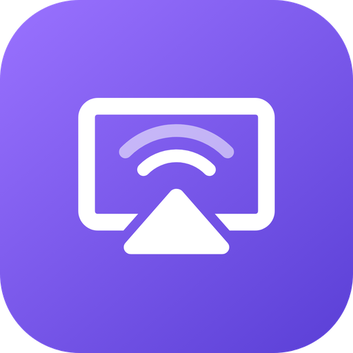
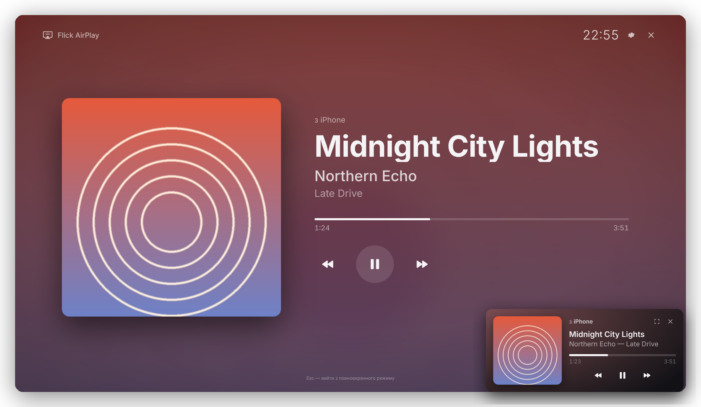
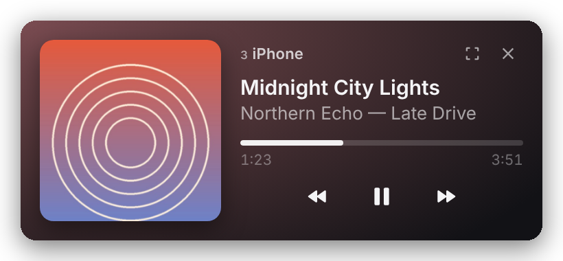
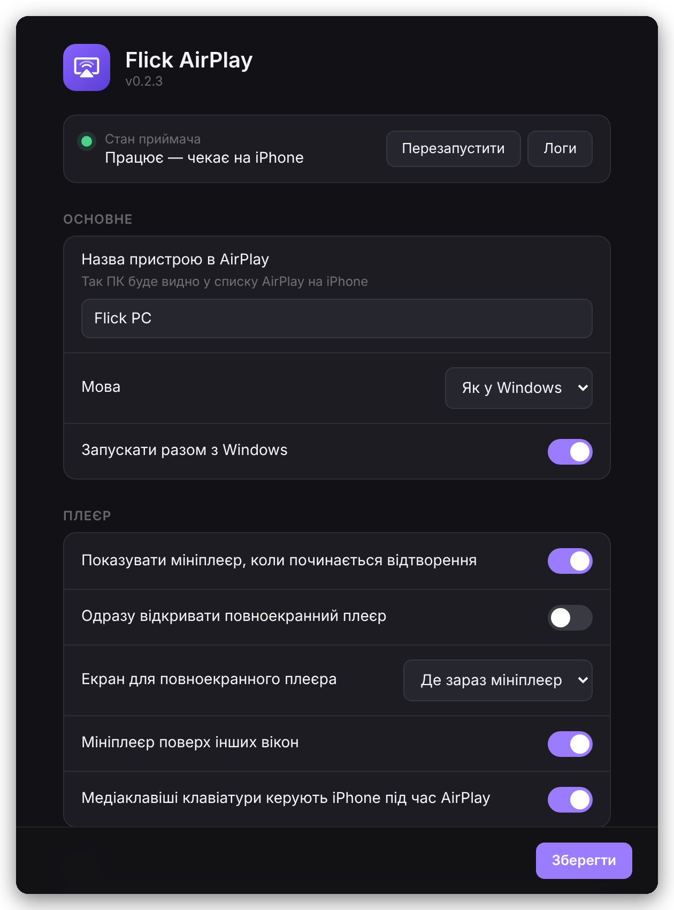

<div align="center">



# Flick AirPlay для Windows

**Музика, YouTube і екран iPhone — на твоєму ПК через AirPlay.**<br>
Як Apple TV або колонка з AirPlay, тільки це твій комп'ютер.

[](https://github.com/sergvo1kov/flick-pc-airplay/releases/latest)
[](https://github.com/sergvo1kov/flick-pc-airplay/releases)
[](https://github.com/sergvo1kov/flick-pc-airplay/actions/workflows/build.yml)

[](LICENSE)

### [⬇️ Завантажити інсталятор](https://github.com/sergvo1kov/flick-pc-airplay/releases/latest)



[Українська](#можливості) · [English](#english)

</div>

## Можливості

| | |
|---|---|
| 🎵 **Музика без втрат** | Apple Music, Spotify, YouTube Music, подкасти — звук ALAC, гучність регулюється з iPhone |
| 🖼️ **Зараз грає** | Обкладинка, назва, виконавець, альбом і прогрес треку — у мініплеєрі в кутку або на весь екран |
| ⏯️ **Керування з ПК** | Пауза й перемикання треків кнопками плеєра, медіаклавішами клавіатури, з трею або зі Stream Dock |
| 📺 **YouTube** | Кнопка AirPlay у застосунку YouTube показує відео на ПК |
| 📱 **Повтор екрана** | Екран iPhone чи iPad на моніторі або ТВ, під'єднаному до ПК |
| 🔄 **Автооновлення** | Нові версії завантажуються у фоні й ставляться в один клік |
| 🌐 **Три мови** | Українська, російська, англійська — за мовою Windows |

Bonjour від Apple, iTunes та інші програми ставити **не потрібно** — усе вже всередині.

## Встановлення

1. Завантаж **`FlickAirPlay-Setup-x.y.z.exe`** з [останнього релізу](https://github.com/sergvo1kov/flick-pc-airplay/releases/latest) і запусти.
2. Windows SmartScreen може попередити, що видавець невідомий (інсталятор не підписаний платним сертифікатом): **«Докладніше» → «Виконати все одно»**.
3. Інсталятор попросить права адміністратора — щоб відкрити брандмауер для AirPlay у приватних мережах.
4. Перевір, що домашня мережа у Windows **Приватна**: Параметри → Мережа та Інтернет → Wi-Fi → властивості мережі → Тип профілю. Якщо вона «Загальнодоступна», застосунок підкаже.

## Як користуватися

**Музика:** Пункт керування на iPhone → картка музики → значок AirPlay → вибери свій ПК (за замовчуванням «Flick AirPlay», назва змінюється в налаштуваннях).

**YouTube:** у плеєрі YouTube натисни значок AirPlay → твій ПК.

**Повтор екрана:** Пункт керування → «Повтор екрана» → твій ПК. Alt+Enter — вікно / весь екран.

<p align="center">
  &nbsp;&nbsp;
  
</p>

| Дія | Як |
|---|---|
| Пауза / продовжити | кнопка в плеєрі, `Пробіл`, медіаклавіша Play/Pause, меню трею |
| Наступний / попередній | кнопки, `→` / `←`, медіаклавіші |
| Гучність iPhone | `↑` / `↓` у плеєрі або кнопки гучності на самому iPhone |
| Повноекранний плеєр | кнопка ⛶ у мініплеєрі, `F`, подвійний клік по значку в треї; вихід — `Esc` |

### Stream Dock, Stream Deck і ярлики

Кожна кнопка — дія «Відкрити програму» з аргументом:

```
"C:\Program Files\FlickAirPlay\FlickAirPlay.exe" --cmd=playpause
```

Команди: `playpause` · `next` · `prev` · `volup` · `voldown` · `full` · `mini` · `settings`. Команда миттєво передається вже запущеному застосунку, друге вікно не відкривається.

### Що не покажеться

Netflix, Apple TV+, Disney+ та інші сервіси із захистом DRM через AirPlay віддають лише звук, без картинки. Це обмеження протоколу, а не застосунку.

## Якщо щось не так

| Проблема | Що зробити |
|---|---|
| iPhone не бачить ПК | Мережа у Windows має бути **Приватною**; iPhone і ПК — в одній мережі |
| Керування з ПК не працює | Онови до останньої версії: **Налаштування → Оновлення → Перевірити** |
| Інше | Трей → «Відкрити папку логів» → прикріпи `flick-airplay.log` до [issue](https://github.com/sergvo1kov/flick-pc-airplay/issues) |

Що змінилось у кожній версії — у [CHANGELOG.md](CHANGELOG.md).

## Як це влаштовано

```
iPhone ──AirPlay──▶ uxplay.exe (рушій, GStreamer) ──▶ звук і відео у Windows
   ▲                     │  метадані / обкладинка / пульт / журнал
   │                     ▼
   └──DACP (пульт)── Flick AirPlay (Electron): трей, плеєр, налаштування
```

- **Рушій** — [UxPlay](https://github.com/FDH2/UxPlay), зібраний під Windows разом з GStreamer. Своя служба mDNS, тож Bonjour не потрібен.
- **Пульт** — протокол DACP: застосунок знаходить у мережі пульт iPhone (`iTunes_Ctrl_<ID>`) і надсилає йому `playpause`, `nextitem` тощо — так само, як це роблять колонки з AirPlay.
- **Пауза** — iOS при паузі просто зупиняє потік. Плеєр заморожує прогрес і тримає картку треку до 15 хвилин.

<details>
<summary><b>Збірка і випуск версій</b></summary>

Усе збирається в GitHub Actions (`.github/workflows/build.yml`): UxPlay під MSYS2, пакування рушія з GStreamer, перевірка рушія в ізоляції (кодеки, HTTPS, справжні HLS-потоки), інсталятор NSIS.

Нова версія: підніми `version` у `package.json`, додай розділ у `CHANGELOG.md` і запуш у `main`. CI сам створить тег `vX.Y.Z`, реліз з описом із CHANGELOG і фід оновлень (`latest.yml`), а потім перевірить, що застосунок у користувача зможе його завантажити.

```bash
npm test                               # юніт-тести: mDNS, DACP з емуляцією iPhone, сесія, оновлення
python3 tests/ui/render.py shots uk    # скриншоти вікон з тестовими даними
```

</details>

---

<a id="english"></a>

## English

**Flick AirPlay** turns a Windows PC into an AirPlay receiver for iPhone and iPad.

- **Music** in lossless ALAC with cover art, track info and progress — in a corner mini player or full screen
- **Control from the PC**: play/pause and skip with the player buttons, keyboard media keys, the tray or a Stream Dock (`FlickAirPlay.exe --cmd=playpause|next|prev|…`)
- **YouTube** videos via the AirPlay button in the YouTube app, and **screen mirroring**
- **Automatic updates**, no Bonjour or iTunes required, UI in Ukrainian, Russian and English

**Install:** download `FlickAirPlay-Setup-x.y.z.exe` from the [latest release](https://github.com/sergvo1kov/flick-pc-airplay/releases/latest). If SmartScreen warns about an unknown publisher, choose *More info → Run anyway*. Make sure your home network is set to **Private** in Windows.

DRM-protected services (Netflix, Apple TV+, …) send audio only over AirPlay.

---

<div align="center">

Автор — **Serhii Volkov** ([@sergvo1kov](https://github.com/sergvo1kov)) · [GPL-3.0](LICENSE) · Сторонні компоненти: [THIRD_PARTY.md](THIRD_PARTY.md)<br>
Рушій AirPlay — [UxPlay](https://github.com/FDH2/UxPlay). AirPlay, iPhone та iPad — торговельні марки Apple Inc.; проєкт не пов'язаний з Apple.

</div>
